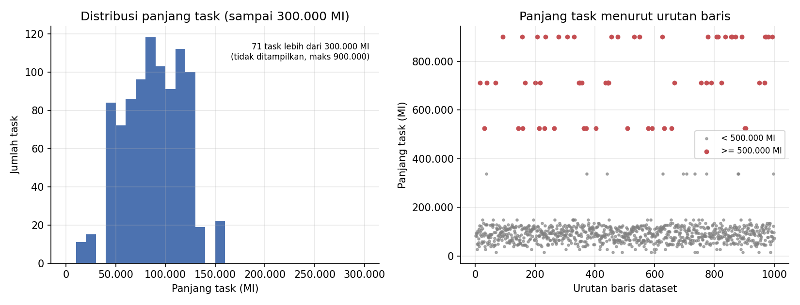
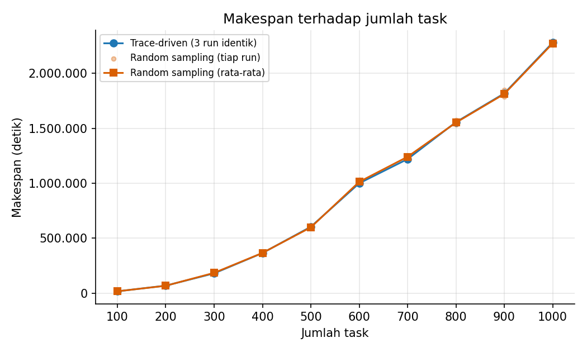
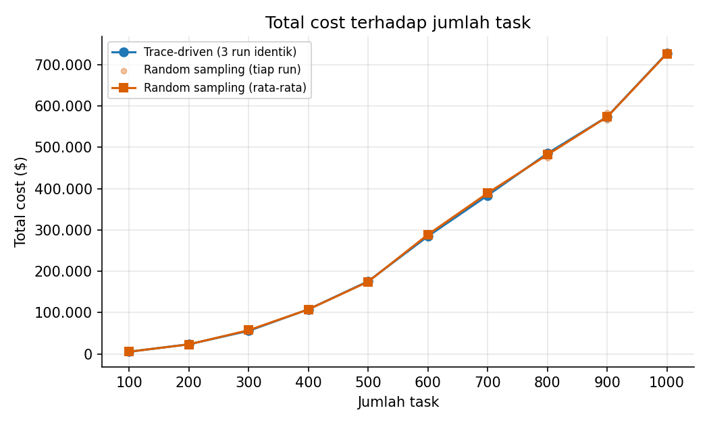
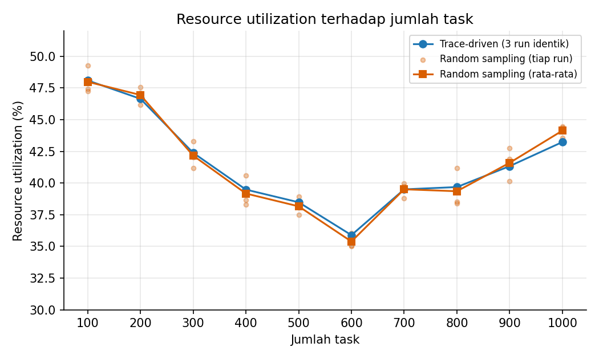
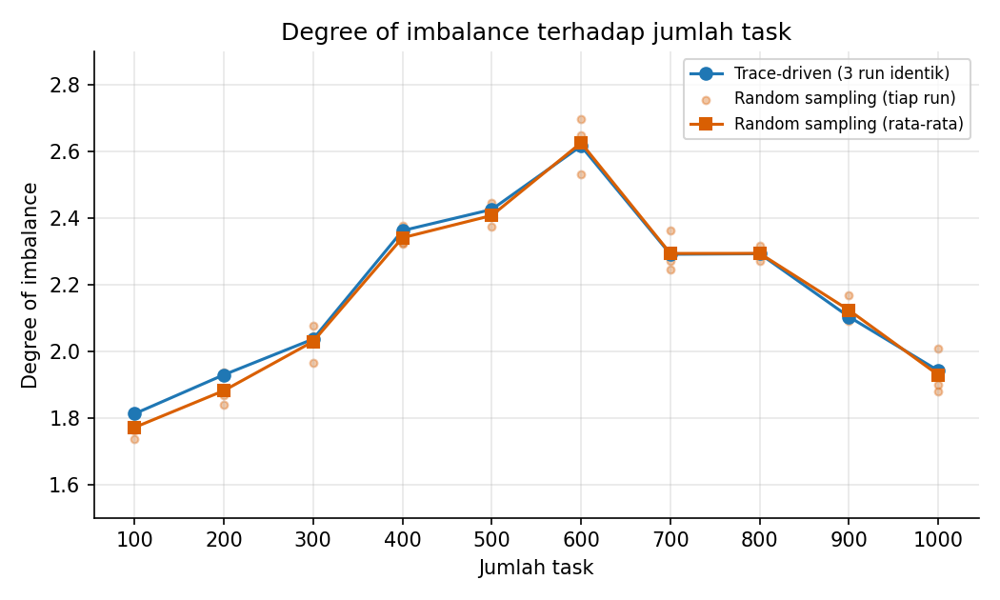
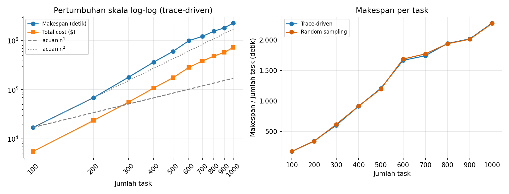
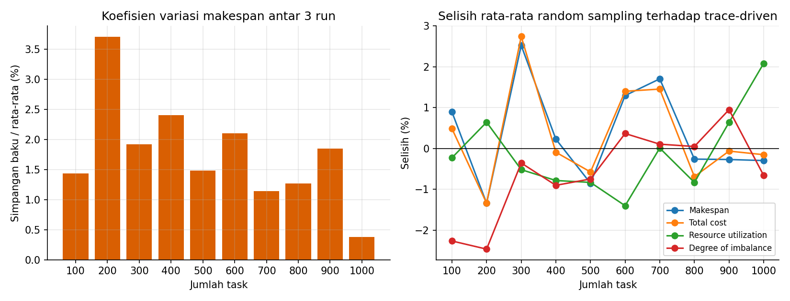
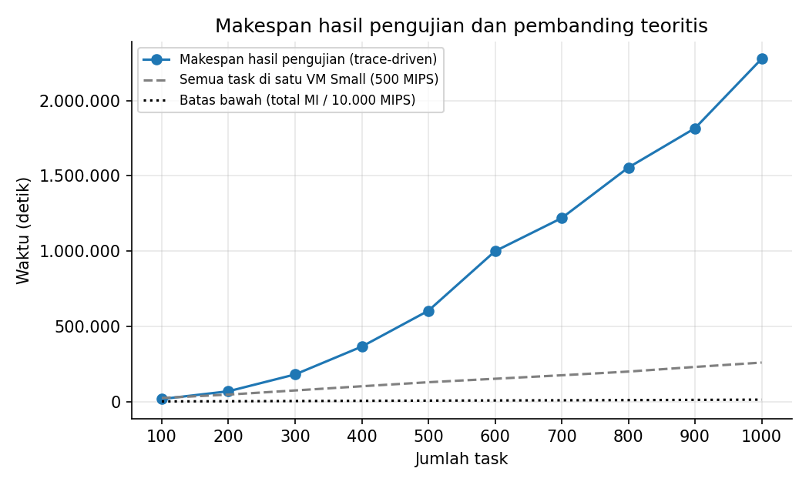

# Simulasi Penjadwalan Tugas Cloud dengan Opportunistic Load Balancing (OLB)

Repositori ini berisi simulasi penjadwalan tugas pada lingkungan cloud heterogen menggunakan CloudSim Plus 7.3.0 dan algoritma Opportunistic Load Balancing (OLB). Beban kerja diambil dari dataset Google Cloud Jobs (GoCJ). Kinerja algoritma diukur dengan empat metrik: makespan, total cost, resource utilization, dan degree of imbalance.

## 1. Tujuan

Pengujian ini ingin melihat bagaimana OLB bekerja pada 10 VM dengan kapasitas berbeda-beda ketika jumlah task dinaikkan dari 100 sampai 1.000, dan bagaimana keempat metrik berubah mengikuti kenaikan itu.

## 2. Algoritma OLB

OLB memberikan setiap task yang datang kepada VM yang paling cepat tersedia (ready time terkecil). Panjang task dan kecepatan VM tidak ikut dipertimbangkan. Langkah yang dijalankan pada kode:

1. Ready time setiap VM diisi 0.
2. Untuk setiap task dalam antrean, dipilih VM dengan ready time terkecil.
3. Task dipasangkan ke VM tersebut.
4. Ready time VM terpilih ditambah durasi task, yaitu `panjang task / (jumlah PE x MIPS VM)`.
5. Setelah seluruh task terpetakan, daftar task diserahkan ke broker untuk dieksekusi simulator.

Kompleksitasnya O(n x m) dengan n jumlah task dan m jumlah VM. Karena hanya melihat ready time, OLB cenderung membagi jumlah task secara merata, tetapi tidak peduli apakah task yang panjang jatuh ke VM yang lambat.

## 3. Konfigurasi simulasi

### 3.1 Host fisik

Satu datacenter dengan 4 host. Semua host memiliki bandwidth 10.000 Mbps dan storage 1.000.000 MB.

| Host | Grade | Core | MIPS per core | RAM |
| :--- | :--- | :---: | :---: | :---: |
| Host 0, Host 1 | High Performance | 4 | 2.000 | 16 GB |
| Host 2, Host 3 | Standard | 4 | 1.000 | 8 GB |

### 3.2 Mesin virtual

| VM | Tipe | vCPU | MIPS per core | RAM | Tarif per detik |
| :--- | :--- | :---: | :---: | :---: | :---: |
| VM 0 - VM 1 | LARGE | 2 | 1.000 | 4 GB | $0,12 |
| VM 2 - VM 5 | MEDIUM | 1 | 1.000 | 2 GB | $0,05 |
| VM 6 - VM 9 | SMALL | 1 | 500 | 1 GB | $0,02 |

Total kapasitas 10 VM adalah 12 core dan 10.000 MIPS.

### 3.3 Penempatan VM ke host

Penempatan memakai `GradedVmAllocationPolicy`. VM LARGE dan MEDIUM diarahkan ke host High Performance, VM SMALL ke host Standard. Jika host tujuan penuh, dicari host lain yang masih muat. Hasil penempatannya:

| Host | VM yang ditempatkan |
| :--- | :--- |
| Host 0 | VM 0, VM 1 (LARGE) |
| Host 1 | VM 2, VM 3, VM 4, VM 5 (MEDIUM) |
| Host 2 | VM 6, VM 7, VM 8, VM 9 (SMALL) |
| Host 3 | tidak ada VM (cadangan) |

### 3.4 Dataset

`GoCJ_Dataset_1000.csv` berisi 1.000 baris tanpa header. Program hanya memakai kolom pertama sebagai panjang task dalam MI (million instructions). Kolom kedua dan ketiga tidak dipakai dalam perhitungan.

Panjang task berkisar dari 15.000 sampai 900.000 MI dengan median 93.000 MI. Sebanyak 929 task panjangnya tidak lebih dari 160.000 MI. Sisanya terkumpul pada beberapa nilai besar: 11 task bernilai 337.500 MI, 16 task 525.000 MI, 20 task 712.500 MI, dan 24 task 900.000 MI. Enam puluh task yang panjangnya 500.000 MI ke atas hanya 6% dari jumlah baris, tetapi menyumbang 34,1% dari total MI (129.662.000 MI).



### 3.5 Skenario pengujian

Ada dua pendekatan, masing-masing dengan 10 variasi jumlah task (100, 200, sampai 1.000) dan 3 kali pengulangan, sehingga totalnya 60 run.

- Trace-driven: task dibaca berurutan dari baris pertama sampai ke-N. Dataset, spesifikasi VM, dan algoritma tidak berubah, jadi ketiga run pada jumlah task yang sama menghasilkan angka yang identik.
- Random sampling: pada setiap run, N task diambil secara acak dari 1.000 baris. Untuk 1.000 task, seluruh baris dipakai dengan urutan kedatangan yang diacak.

## 4. Metrik evaluasi

```text
Makespan             = max(ExecutionTime_j) untuk seluruh VM j
Total Cost           = jumlah (ActualCpuTime_i x tarif VM yang menjalankan task i)
Resource Utilization = jumlah(ExecutionTime_j) / (m x Makespan) x 100%
Degree of Imbalance  = (max(ExecutionTime) - min(ExecutionTime)) / rata-rata(ExecutionTime)
```

Pada kode, `ExecutionTime_j` adalah jumlah `actualCpuTime` seluruh cloudlet yang dijalankan VM j, dan m = 10. Definisi makespan ini perlu diperhatikan saat membaca hasil, lihat bagian 7.

## 5. Cara menjalankan

Prasyarat: JDK 21 dan Maven. Semua perintah dijalankan dari root repositori karena dataset dibaca lewat path relatif.

```powershell
mvn compile exec:java "-Dexec.mainClass=OlbSimulation"
mvn compile exec:java "-Dexec.mainClass=OlbBenchmark"
mvn compile exec:java "-Dexec.mainClass=SyntheticExperimentRunner"
```

`OlbSimulation` menjalankan satu simulasi dengan jumlah task pada variabel `jumlahTask` (bawaan 100) dan mencetak pemetaan VM ke host, tabel eksekusi, serta empat metrik. `OlbBenchmark` menjalankan 30 run trace-driven dan menulis hasilnya ke `HASIL_PENGUJIAN.md`, sehingga berkas yang sudah ada akan tertimpa. `SyntheticExperimentRunner` memakai dataset sintetis (1.000 sampai 10.000 task, panjang acak 1.000 sampai 100.000 MI); hasil dari program ini belum dicantumkan di README.

Untuk membuat ulang grafik dari `HASIL_PENGUJIAN.md`:

```bash
pip install pandas matplotlib jupyter && jupyter nbconvert --to notebook --execute --inplace analisis_olb.ipynb
```

Grafik tersimpan di folder `grafik/`.

## 6. Hasil pengujian

### 6.1 Trace-driven (rata-rata 3 run)

| Jumlah task | Makespan (detik) | Total cost ($) | Resource utilization | Degree of imbalance |
| :---: | :---: | :---: | :---: | :---: |
| 100 | 17.078,41 | 5.541,19 | 48,09 % | 1,8122 |
| 200 | 68.599,70 | 23.585,50 | 46,64 % | 1,9292 |
| 300 | 180.452,95 | 56.043,04 | 42,38 % | 2,0365 |
| 400 | 365.392,41 | 108.063,04 | 39,48 % | 2,3621 |
| 500 | 604.126,77 | 175.949,00 | 38,48 % | 2,4258 |
| 600 | 999.698,09 | 284.846,28 | 35,89 % | 2,6162 |
| 700 | 1.219.718,22 | 383.690,51 | 39,50 % | 2,2913 |
| 800 | 1.555.496,54 | 485.351,93 | 39,68 % | 2,2928 |
| 900 | 1.817.028,95 | 573.980,85 | 41,33 % | 2,1033 |
| 1000 | 2.278.486,77 | 727.760,54 | 43,23 % | 1,9416 |

### 6.2 Random sampling (rata-rata 3 run)

| Jumlah task | Makespan (detik) | Total cost ($) | Resource utilization | Degree of imbalance |
| :---: | :---: | :---: | :---: | :---: |
| 100 | 17.231,00 | 5.568,02 | 47,98 % | 1,7711 |
| 200 | 67.679,36 | 23.269,36 | 46,94 % | 1,8816 |
| 300 | 185.005,43 | 57.579,89 | 42,16 % | 2,0292 |
| 400 | 366.223,81 | 107.963,49 | 39,17 % | 2,3408 |
| 500 | 598.977,20 | 174.936,13 | 38,16 % | 2,4077 |
| 600 | 1.012.650,74 | 288.834,82 | 35,39 % | 2,6258 |
| 700 | 1.240.509,13 | 389.269,37 | 39,50 % | 2,2937 |
| 800 | 1.551.434,63 | 482.001,94 | 39,35 % | 2,2939 |
| 900 | 1.812.110,49 | 573.609,57 | 41,59 % | 2,1233 |
| 1000 | 2.271.726,63 | 726.647,92 | 44,13 % | 1,9288 |

Data lengkap 60 run ada di `HASIL_PENGUJIAN.md`.

### 6.3 Grafik

Pada grafik trace-driven, tiga run bernilai sama sehingga hanya tampak satu garis. Pada random sampling, titik pucat adalah tiap run dan garisnya adalah rata-rata.









## 7. Pembahasan

### Makespan dan total cost

Pada trace-driven, makespan naik dari 17.078,41 detik (100 task) menjadi 2.278.486,77 detik (1.000 task), atau sekitar 133 kali lipat untuk kenaikan jumlah task 10 kali. Total cost naik dari 5.541,19 dolar menjadi 727.760,54 dolar, sekitar 131 kali lipat. Regresi log-log terhadap rata-rata tiap jumlah task memberi eksponen 2,17 untuk makespan dan 2,15 untuk cost, jadi pertumbuhannya mendekati kuadratik dan tidak linear. Makespan per task ikut membesar, dari 170,8 detik pada 100 task menjadi 2.278,5 detik pada 1.000 task. Rasio cost terhadap makespan relatif tetap di kisaran 0,29 sampai 0,34, artinya biaya bergerak mengikuti makespan. Random sampling menunjukkan pola yang sama dengan eksponen 2,17 dan 2,15.



### Resource utilization

Utilisasi berada di antara 35,89% dan 48,09% pada trace-driven, dan antara 35,39% dan 47,98% pada random sampling. Nilainya turun dari 100 sampai 600 task, lalu naik lagi sampai 43,23% (trace-driven) dan 44,13% (random sampling) pada 1.000 task. Dengan nilai di bawah 50%, rata-rata VM hanya bekerja kurang dari separuh waktu makespan, sementara VM yang paling lama bekerja yang menentukan makespan.

### Degree of imbalance

DI selalu di atas 1,7. Pada trace-driven nilainya 1,8122 pada 100 task, mencapai puncak 2,6162 pada 600 task, lalu turun menjadi 1,9416 pada 1.000 task. Random sampling punya bentuk yang sama: 1,7711, puncak 2,6258 pada 600 task, dan 1,9288 pada 1.000 task. Nilai DI di atas 1 berarti selisih antara VM terpadat dan VM terlonggar lebih besar daripada beban rata-rata VM. Penyebab turunnya DI setelah 600 task tidak diselidiki lebih jauh dalam pengujian ini.

### Trace-driven dibandingkan random sampling

Rata-rata random sampling berbeda paling jauh 2,74% dari hasil trace-driven (makespan 2,52%, cost 2,74%, utilization 2,08%, imbalance 2,47%). Antar tiga run random sampling pada jumlah task yang sama, koefisien variasi makespan berkisar 0,38% sampai 3,70%. Bentuk kurva kedua pendekatan hampir berimpit, jadi pola yang terlihat tidak bergantung pada urutan baris tertentu di dataset.



## 8. Catatan dan keterbatasan

1. Definisi makespan. Makespan pada kode adalah nilai terbesar dari jumlah `actualCpuTime` seluruh cloudlet pada satu VM, bukan waktu selesai terakhir pada jam simulasi. Angkanya perlu dibaca dengan hati-hati. Total 1.000 task bernilai 129.662.000 MI. Dibagi total kapasitas 10.000 MIPS, batas bawah waktu selesainya sekitar 12.966 detik, dan bila seluruh task dikerjakan satu VM SMALL (500 MIPS) saja waktunya 259.324 detik. Makespan hasil pengujian pada 1.000 task adalah 2.278.486,77 detik, jauh di atas keduanya. Mulai 200 task, nilainya sudah melebihi waktu satu VM SMALL mengerjakan semua task sendirian (68.599,70 dibanding 46.524 detik). Penjumlahan `actualCpuTime` dapat jauh lebih besar dari waktu selesai sebenarnya bila cloudlet pada satu VM berjalan bersamaan dan berbagi kapasitas, seperti pada penjadwal time-shared bawaan CloudSim Plus yang dipakai `OlbSimulation` dan `OlbBenchmark` (`SyntheticExperimentRunner` memakai `CloudletSchedulerSpaceShared`). Ini dugaan yang belum diuji dengan menjalankan ulang simulasi. Bila yang diinginkan adalah waktu selesai sebenarnya, nilainya dapat diambil dari `getFinishTime()` terbesar di antara cloudlet.

   

2. Estimasi durasi pada OLB memakai kapasitas total VM (jumlah PE x MIPS), sedangkan setiap cloudlet hanya meminta 1 PE. Untuk VM LARGE, estimasi ini tidak sama persis dengan cara simulator mengeksekusi task.

3. Hasil random sampling pada README ini diambil dari `HASIL_PENGUJIAN.md`. `OlbBenchmark.java` pada repositori hanya membaca dataset secara berurutan, sedangkan pengacakan (`Collections.shuffle` tanpa seed) hanya ada di `OlbSimulation`. Karena itu angka random sampling tidak otomatis terbentuk ulang oleh `OlbBenchmark`, dan hasil run acak yang diulang akan sedikit berbeda.

4. Pengujian ini baru mencakup OLB. Belum ada perbandingan dengan algoritma penjadwalan lain pada konfigurasi dan dataset yang sama.

## 9. Kesimpulan

Pada 10 VM heterogen dengan dataset GoCJ, makespan dan total cost hasil pengujian OLB naik mendekati kuadratik terhadap jumlah task (eksponen sekitar 2,15 sampai 2,17), resource utilization berada di kisaran 35% sampai 48%, dan degree of imbalance berada di kisaran 1,77 sampai 2,63 dengan puncak pada 600 task. Hasil trace-driven dan random sampling hanya berbeda maksimal 2,74%, sehingga kedua pendekatan memberi gambaran yang sama. Angka makespan sebaiknya dibaca bersama catatan pada bagian 8 mengenai cara penghitungannya.

## 10. Struktur repositori

```text
.
├── README.md
├── HASIL_PENGUJIAN.md
├── PENCERDASAN.MD
├── analisis_olb.ipynb
├── grafik/
├── pom.xml
└── src/main/
    ├── java/
    │   ├── GradedVmAllocationPolicy.java
    │   ├── OlbSimulation.java
    │   ├── OlbBenchmark.java
    │   ├── SyntheticDataset.java
    │   ├── SyntheticExperimentRunner.java
    │   └── TestCloudSim.java
    └── resources/dataset/GoCJ_Dataset_1000.csv
```
